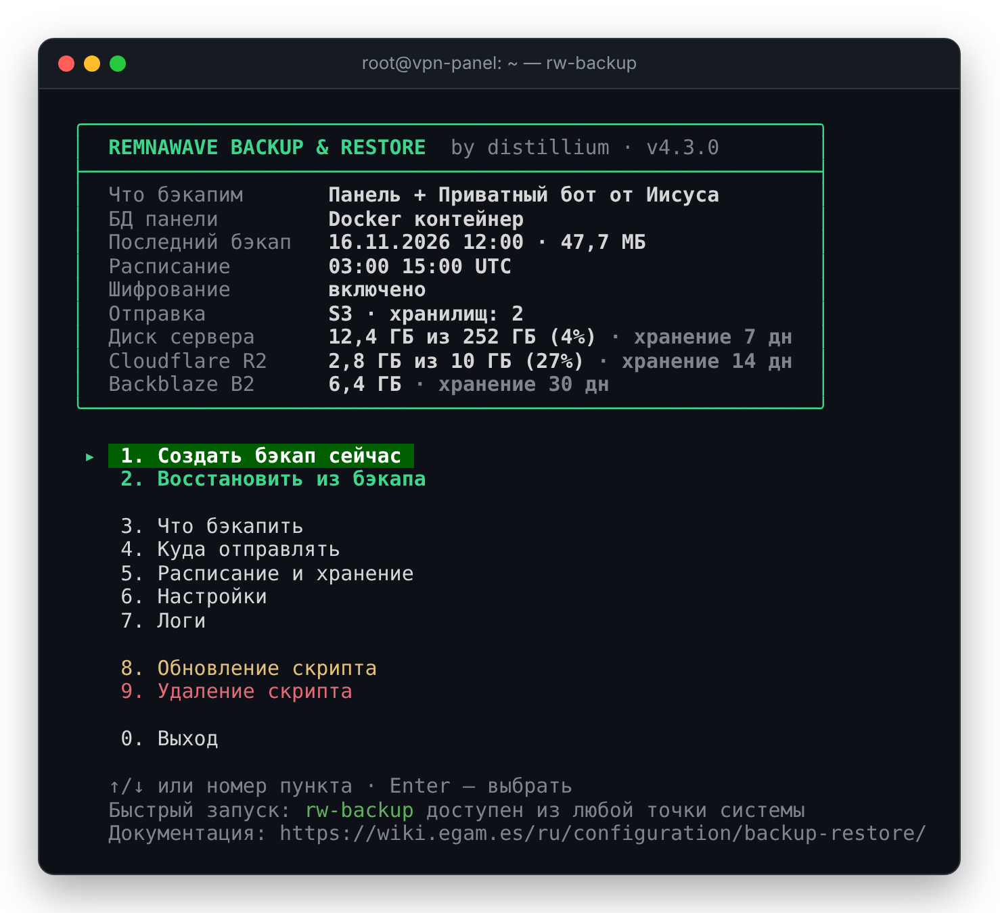

<div align="center">

<a href="https://github.com/distillium/remnawave-backup-restore">
 <picture>
   <source media="(prefers-color-scheme: dark)" srcset="./media/logo.png" />
   <source media="(prefers-color-scheme: light)" srcset="./media/logo-black.png" />
   
 </picture>
</a>

Бэкап и восстановление панели **Remnawave** и **Telegram-магазина**:<br>
по расписанию, в Telegram или S3, с шифрованием и выборочным восстановлением.

[English](README.md) · **Русский**

<details>
<summary><b>Как выглядит меню</b></summary>
<br>



</details>

</div>

> [!CAUTION]
> Скрипт бэкапит только **директорию и БД Remnawave** и, по желанию, **Telegram-магазин**. Остальные сервисы — на вашей стороне.

> [!IMPORTANT]
> С версии 4.3.0 **Google Drive не поддерживается**: скрипт сам переключится на Telegram. Для бэкапов больше 50 МБ подключите S3.

## Установка

```bash
curl -o ~/backup-restore.sh https://raw.githubusercontent.com/distillium/remnawave-backup-restore/main/backup-restore.sh && chmod +x ~/backup-restore.sh && ~/backup-restore.sh
```

Нужен root. После установки меню открывается командой `rw-backup`.

## Подробнее

<details>
<summary><b>Возможности</b></summary>
<br>

- бэкап вручную или по расписанию: панель и бот, только панель или только бот
- Docker-база панели и внешняя PostgreSQL
- отправка в Telegram (личка или топик группы) или в S3-хранилища, до 5 сразу
- сроки хранения на сервере (дни или часы) и в каждом S3 отдельно
- занятое место на диске и в S3, лимит для S3 по желанию
- шифрование ключом [age](https://github.com/FiloSottile/age)
- выборочное восстановление: всё, только база или только файлы
- проверка S3 и прокси Telegram с понятной диагностикой ошибок
- уведомления о новой версии и автообновление

</details>

<details>
<summary><b>Меню</b></summary>
<br>

| № | Пункт | Что внутри |
|:-:|---|---|
| 1 | Создать бэкап сейчас | бэкап по текущим настройкам |
| 2 | Восстановить из бэкапа | выбор архива и того, что восстанавливать |
| 3 | Что бэкапить | панель, бот, режим бэкапа |
| 4 | Куда отправлять | Telegram или S3, список хранилищ |
| 5 | Расписание и хранение | расписание и сроки хранения |
| 6 | Настройки | Telegram, шифрование, язык, автообновление |
| 7 | Логи | бэкап, восстановление, ошибки, cron |

</details>

<details>
<summary><b>Выборочное восстановление</b></summary>
<br>

Если в бэкапе есть и база, и файлы, скрипт спросит, что восстановить:

| Вариант | Что происходит |
|---|---|
| **Всё** | база и файлы |
| **Только база** | том БД пересоздаётся, файлы не трогаются. Панель или бот уже должны быть установлены |
| **Только файлы** | файлы и настройки заменяются, база не трогается |

Удобно, чтобы откатить только базу после неудачного обновления.

</details>

<details>
<summary><b>Шифрование</b></summary>
<br>

Включается в **Настройки → Шифрование**. Бэкап шифруется публичным ключом [age](https://github.com/FiloSottile/age), на сервере хранится только он. Для восстановления скрипт попросит приватный ключ.

**Важно:** без приватного ключа зашифрованный бэкап не восстановить. Храните его отдельно от сервера.

</details>

<details>
<summary><b>Поддерживаемые боты</b></summary>
<br>

| Бот | Папка |
|---|---|
| Бот от Иисуса | `remnawave-telegram-shop` |
| Приватный бот от Иисуса | `rwp-shop` |
| Бот от Мачки | `remnawave-tg-shop` |
| Бот от Snoups | `remnashop` |
| Бот Minishop | `remnawave-minishop` |

</details>

<details>
<summary><b>Переезд на другой сервер</b></summary>
<br>

<blockquote>

<details>
  <summary>◦ Только панель: переход на новый сервер</summary>
  <br>

1. В Cloudflare направьте поддомен панели на новый IP. Если на новый сервер переезжают и другие сервисы, обновите и их поддомены.
2. Восстановите директорию и БД.
3. Если нужно, восстановите сертификаты для домена.
4. Ссылка доступа и пароль останутся от старой панели, с которой делался бэкап.
5. На всех нодах замените правило для сервисного порта (по умолчанию 2222), чтобы панель с новым IP могла с ними связаться. Выполните на каждой ноде, подставив свои `OLD_IP` и `NEW_IP`:

```bash
ufw delete allow from OLD_IP to any port 2222 && ufw allow from NEW_IP to any port 2222
```

Готово. Осталось поставить и настроить остальные нужные сервисы (например, kuma, beszel).

</details>

<details>
  <summary>◦ Панель + нода: переход на новый сервер</summary>
  <br>

1. В Cloudflare направьте на новый IP поддомены панели и «корневой» ноды (которая стоит вместе с панелью). Если на новый сервер переезжают и другие сервисы, обновите и их поддомены.
2. Если нужно, восстановите сертификаты для домена.
3. Восстановите директорию и БД.
4. Откройте доступ к панели через порт 8443 (скрипт от eGames, пункт «Управление доступом к панели»).
5. Ссылка доступа и пароль останутся от старой панели, с которой делался бэкап.
6. В управлении нодами найдите корневую ноду. В ней указан адрес старого сервера: замените его на новый, и нода включится сама.
7. Закройте доступ к панели через порт 8443 так же, как открывали.
8. На всех внешних нодах замените правило для сервисного порта (по умолчанию 2222). Выполните на каждой ноде, подставив свои `OLD_IP` и `NEW_IP`:

```bash
ufw delete allow from OLD_IP to any port 2222 && ufw allow from NEW_IP to any port 2222
```

Готово. Осталось поставить и настроить остальные нужные сервисы (например, kuma, beszel).

</details>

<details>
  <summary>◦ Панель + нода → «Только панель» на текущем сервере</summary>
  <br>

1. Восстановите директорию и БД.
2. Ссылка доступа и пароль останутся от старой панели, с которой делался бэкап.
3. Удалите из панели старую «корневую» ноду вместе с её инбаундом и хостом.
4. Удалите файл `.env-node` с сервера панели:

```bash
rm /opt/remnawave/.env-node
```

Готово. Осталось поставить и настроить остальные нужные сервисы (например, kuma, beszel).

</details>

<details>
  <summary>◦ Панель + нода → «Только панель» на новом сервере</summary>
  <br>

1. В Cloudflare направьте поддомен панели на новый IP. Если на новый сервер переезжают и другие сервисы, обновите и их поддомены.
2. Если нужно, восстановите сертификаты для домена.
3. Восстановите директорию и БД.
4. Ссылка доступа и пароль останутся от старой панели, с которой делался бэкап.
5. Удалите из панели старую «корневую» ноду вместе с её инбаундом и хостом.
6. Удалите файл `.env-node` с сервера панели:

```bash
rm /opt/remnawave/.env-node
```

7. На всех нодах замените правило для сервисного порта (по умолчанию 2222). Выполните на каждой ноде, подставив свои `OLD_IP` и `NEW_IP`:

```bash
ufw delete allow from OLD_IP to any port 2222 && ufw allow from NEW_IP to any port 2222
```

Готово. Осталось поставить и настроить остальные нужные сервисы (например, kuma, beszel).

</details>

</blockquote>

</details>

<details>
<summary><b>Команды и файлы</b></summary>
<br>

| Команда | Что делает |
|---|---|
| `rw-backup` | открыть меню |
| `rw-backup backup` | бэкап без меню (так работает расписание) |
| `rw-backup restore` | восстановление |
| `rw-backup update` | обновить скрипт |
| `rw-backup remove` | удалить скрипт |

Всё хранится в `/opt/rw-backup-restore`: настройки в `config.env`, бэкапы в `backup/`, логи в `logs/`.

</details>

<div align="center">

## Поддержать проект

<p align="center">
  <a href="https://t.me/tribute/app?startapp=dRNM">
    
  </a>
  &nbsp;
  <a href="https://web.tribute.tg/d/RNM">
    
  </a>
</p>

Спасибо за вашу поддержку!

</div>
