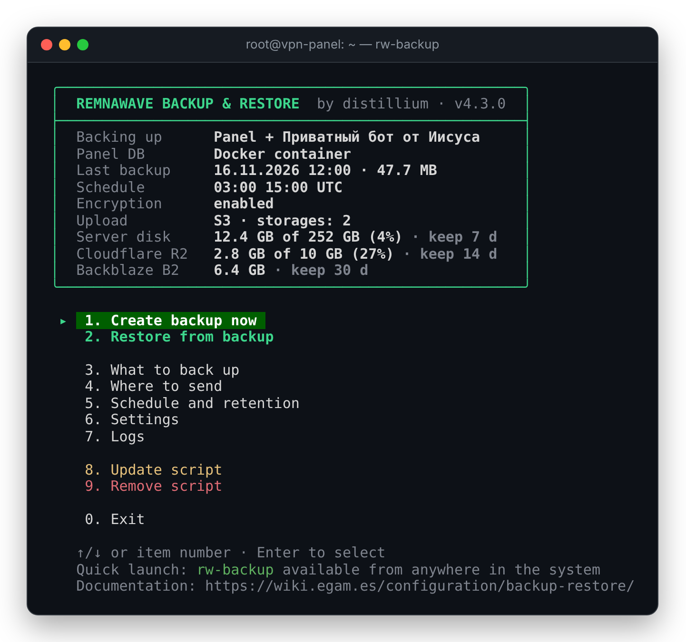

<div align="center">

<a href="https://github.com/distillium/remnawave-backup-restore">
 <picture>
   <source media="(prefers-color-scheme: dark)" srcset="./media/logo.png" />
   <source media="(prefers-color-scheme: light)" srcset="./media/logo-black.png" />
   
 </picture>
</a>



Backup and restore for the **Remnawave** panel and your **Telegram shop** in one script:<br>
scheduled, sent to Telegram or S3, encrypted, with selective restore.

<a href="https://github.com/distillium/remnawave-backup-restore/releases/latest"></a>

<a href="https://github.com/distillium/remnawave-backup-restore/stargazers"></a>

**🇬🇧 English** · [🇷🇺 Русский](README-RU.md)

</div>

> [!CAUTION]
> The script backs up and restores the **Remnawave directory and database**, and optionally a **Telegram shop**. Backing up and restoring any other services and settings is up to you. Read the script's prompts carefully before confirming any action.

> [!IMPORTANT]
> **Google Drive is no longer supported as of 4.3.0.** If your backups went to Google Drive, the script switches to Telegram on its own and tells you about it. For backups over 50 MB, connect S3.

## 🚀 Installation

Requires root.

```bash
curl -o ~/backup-restore.sh https://raw.githubusercontent.com/distillium/remnawave-backup-restore/main/backup-restore.sh && chmod +x ~/backup-restore.sh && ~/backup-restore.sh
```

On the first run the script asks for the language, the mode and your Telegram details, then installs itself into `/opt/rw-backup-restore`. After that, open the menu with `rw-backup` from any directory.

## ✨ Features

**Backup**
- manual from the menu or automatic on a schedule
- three modes: panel and bot, panel only, bot only
- works with the panel's Docker database and with external PostgreSQL
- the archive name tells what's inside: `full`, `panel` or `bot`
- optional encryption with an [age](https://github.com/FiloSottile/age) key

**Upload and retention**
- to Telegram (a direct chat with the bot or a group topic) or to S3-compatible storage, up to 5 at once
- size check before sending to Telegram (50 MB limit), with a notice when a backup doesn't fit
- separate retention periods on the server (days or hours) and in each S3
- disk and S3 usage in the main menu and in notifications, with an optional limit for S3

**Restore**
- selective: everything, database only or files only, separately for the panel and the bot
- backup metadata shown before restoring: script version, panel version, dump type
- database name and user are taken from the container automatically

**Convenience**
- menus with arrow keys, number selection and Esc to go back
- status card: what is backed up, last backup, schedule, encryption, disk usage
- S3 connection and Telegram proxy tests with clear error diagnostics
- test message to Telegram from the settings
- new version notices and optional auto-update
- local backups can be kept when removing the script

<details>
<summary>🤖 Supported Telegram bots</summary>
<br>

| Bot | Default directory |
|---|---|
| Jesus Bot | `remnawave-telegram-shop` |
| Private Jesus Bot | `rwp-shop` |
| Machka Bot | `remnawave-tg-shop` |
| Snoups Bot | `remnashop` |
| Minishop Bot | `remnawave-minishop` |

The script offers `/opt/…`, `/root/…` and `/opt/stacks/…`, or you can enter your own path.

</details>

## 🧭 Menu

| # | Item | Inside |
|:-:|---|---|
| 1 | **Create a backup now** | a backup with the current settings |
| 2 | **Restore from a backup** | pick an archive and what to restore |
| 3 | **What to back up** | panel backup settings, bot backup settings, backup mode |
| 4 | **Where to send** | Telegram or S3, the list of S3 storages |
| 5 | **Schedule and retention** | backup schedule, retention on the server and in S3 |
| 6 | **Settings** | Telegram, encryption, language, auto-update |
| 7 | **Logs** | backup, restore, system, errors, cron |
| 8 | **Update the script** | |
| 9 | **Remove the script** | |

## 🔄 Selective restore

If a backup has both a database dump and files (for the panel or the bot), the script asks what to restore:

| Option | What happens |
|---|---|
| **Everything** | both the database and the files are restored |
| **Database only** | the DB volume is recreated from scratch, panel or bot files are left as they are. Needs the directory of an already installed panel or bot |
| **Files only** | files and settings are replaced, the database is left as it is |

For example, this lets you roll back only the database after a failed update without touching your current settings.

## 🔐 Encryption

Backups are encrypted with an [age](https://github.com/FiloSottile/age) public key and saved as `.tar.gz.age`. Only the public key is kept on the server, so a backup can't be read even with access to the server or the storage. To restore, the script asks for your private key.

> [!WARNING]
> Keep your private key somewhere safe. Without it an encrypted backup can't be restored.

Turn it on in **Settings → Encryption**: create a new key pair or use your own.

## 📦 Moving to another server

<details>
  <summary>📝 Panel only: moving to a new server</summary>
  <br>

1. In Cloudflare, point the panel subdomain to the new IP. If other services move to the new server too, update their subdomains as well.
2. Restore the directory and the database.
3. Restore the domain certificates if needed.
4. The access link and password stay the same as in the old panel the backup was made from.
5. On every node, replace the rule for the service port (2222 by default) so the panel on the new IP can reach them. Run on each node, with your own `OLD_IP` and `NEW_IP`:

```bash
ufw delete allow from OLD_IP to any port 2222 && ufw allow from NEW_IP to any port 2222
```

Done. All that's left is to install and set up the other services you need (e.g. kuma, beszel).

</details>

<details>
  <summary>📝 Panel + node: moving to a new server</summary>
  <br>

1. In Cloudflare, point the subdomains of the panel and the "root" node (the one on the panel server) to the new IP. If other services move to the new server too, update their subdomains as well.
2. Restore the domain certificates if needed.
3. Restore the directory and the database.
4. Open panel access via port 8443 (eGames script, "Panel access management").
5. The access link and password stay the same as in the old panel the backup was made from.
6. In node management, find the root node. It has the old server address: change it to the new one and the node comes up on its own.
7. Close panel access via port 8443 the same way you opened it.
8. On every external node, replace the rule for the service port (2222 by default). Run on each node, with your own `OLD_IP` and `NEW_IP`:

```bash
ufw delete allow from OLD_IP to any port 2222 && ufw allow from NEW_IP to any port 2222
```

Done. All that's left is to install and set up the other services you need (e.g. kuma, beszel).

</details>

<details>
  <summary>📝 Panel + node → "Panel only" on the current server</summary>
  <br>

1. Restore the directory and the database.
2. The access link and password stay the same as in the old panel the backup was made from.
3. Delete the old "root" node from the panel together with its inbound and host.
4. Delete the `.env-node` file from the panel server:

```bash
rm /opt/remnawave/.env-node
```

Done. All that's left is to install and set up the other services you need (e.g. kuma, beszel).

</details>

<details>
  <summary>📝 Panel + node → "Panel only" on a new server</summary>
  <br>

1. In Cloudflare, point the panel subdomain to the new IP. If other services move to the new server too, update their subdomains as well.
2. Restore the domain certificates if needed.
3. Restore the directory and the database.
4. The access link and password stay the same as in the old panel the backup was made from.
5. Delete the old "root" node from the panel together with its inbound and host.
6. Delete the `.env-node` file from the panel server:

```bash
rm /opt/remnawave/.env-node
```

7. On every node, replace the rule for the service port (2222 by default). Run on each node, with your own `OLD_IP` and `NEW_IP`:

```bash
ufw delete allow from OLD_IP to any port 2222 && ufw allow from NEW_IP to any port 2222
```

Done. All that's left is to install and set up the other services you need (e.g. kuma, beszel).

</details>

## ⌨️ Commands

| Command | What it does |
|---|---|
| `rw-backup` | open the menu |
| `rw-backup backup` | create a backup without the menu (this is what the schedule runs) |
| `rw-backup restore` | restore from a backup |
| `rw-backup update` | update the script |
| `rw-backup remove` | remove the script |

<details>
<summary>📁 Where things live</summary>
<br>

```
/opt/rw-backup-restore/
├── backup-restore.sh   the script
├── config.env          settings (readable by root only)
├── backup/             local backups
├── logs/               logs
└── translations/       translations
```

</details>

<div align="center">

## 💎 Support the Project

<p align="center">
  <a href="https://t.me/tribute/app?startapp=dRNM">
    
  </a>
  &nbsp;
  <a href="https://web.tribute.tg/d/RNM">
    
  </a>
</p>

Thank you for your support! 🙏

</div>
